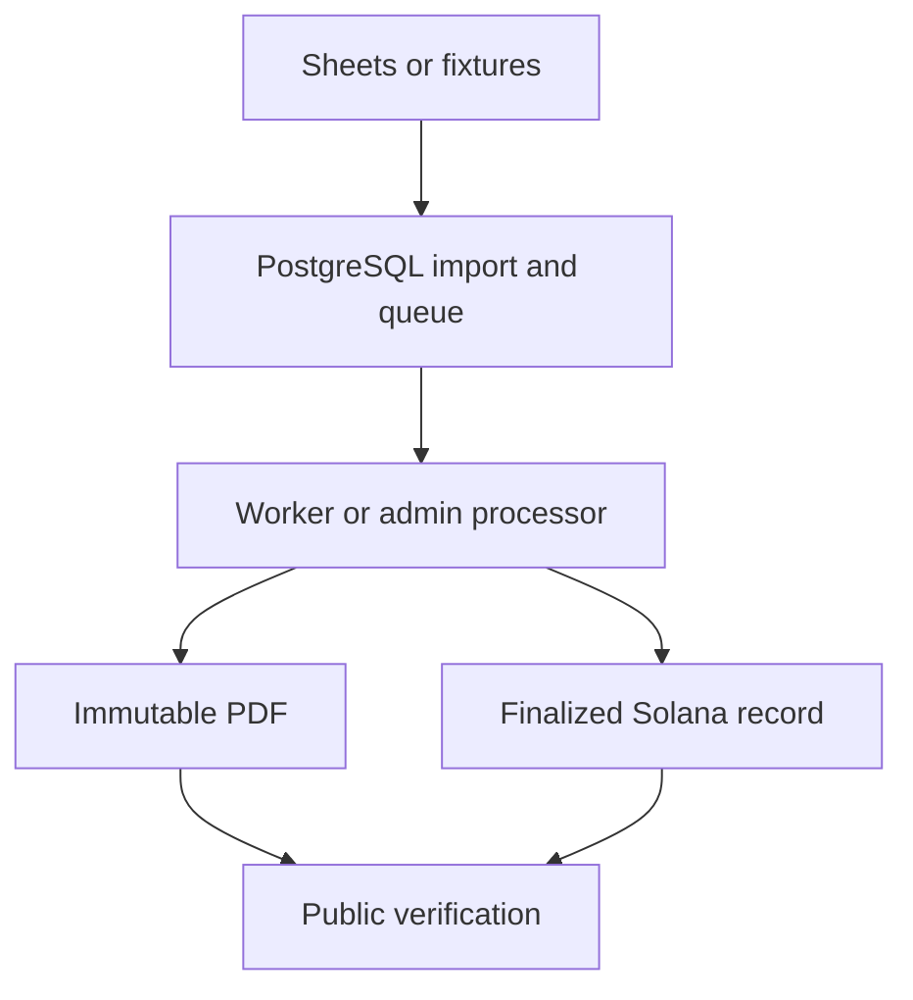

# OrionX · AI Skills Digital Passport

OrionX turns spreadsheet-based skill records into versioned PDF credentials. A PostgreSQL queue coordinates rendering, Solana Devnet registration, and source writeback. Students see their own passports, administrators manage issuance and revocation, and public verifiers can check a code or PDF.

The demonstrator uses synthetic records and a simulated university issuer. Institutional endorsement requires independently pinned trust material. [Trust model](docs/INSTITUTIONAL_TRUST.md)

## Review in five minutes

| Start here | What it shows |
| --- | --- |
| [Public verifier](https://orionx-phi.vercel.app/verify) and [published Devnet fixture](fixtures/verification/devnet.json) | Exact PDF bytes, finalized registration, currency, and issuer trust are checked independently. |
| [Queue and lease code](packages/core/src/jobs.ts) and [recovery test](docs/WORKER_CRASH_TESTING.md) | Two clients claim jobs with row locks. After a worker is killed, another claims the expired lease and the stale worker's commit is rejected. |
| [Isolated revocation suite](scripts/test-revocation-integration.ts) | A loopback validator and PostgreSQL exercise the real program, issuance, revocation, correction, and immutable history. |
| [Historical hosted V3 trace](docs/evidence/hosted-manual.json) | A dated demonstration of a manual admin-triggered issuance from Sheets through finality and writeback. |

## Architecture



A job lease fences state changes. A stable PDF staging key and a persisted signed transaction support recovery across database, storage and RPC boundaries. The public API compares the document hash to the finalized chain account and treats missing evidence as unknown. Older versions keep their original proofs and can be marked superseded or revoked. The PDF scanner uses a bounded search, and reviewers can enter the printed code directly. [Queue design](docs/ADR-QUEUE.md) · [Verification](docs/VERIFICATION.md) · [Security](docs/SECURITY.md)

## Verify from a clean checkout

Use Node.js 22 and npm 10. The fast verification path uses local fixtures and requires no hosted credentials.

```sh
npm ci
npm run db:generate
npm run typecheck
npm test
npm run build
npm audit --audit-level=high
```

[GitHub Actions](https://github.com/GotsadzeLuka/OrionX/actions) runs the workspace checks, isolated validator lifecycle, and a read-only Devnet verifier. For PostgreSQL, worker, benchmark, and validator instructions, see [the verification guide](docs/WORKER_CRASH_TESTING.md).

## Run the app

For local development, copy `.env.example` to `.env.development.local`, start the disposable services with `docker compose up -d`, and generate and initialize the Prisma schema. Start `npm run dev:api` and `npm run dev:web` in separate terminals. The default fixture and offline-chain settings support local development. Google sign-in, Sheets integration, and Devnet signing require the corresponding authorized configuration.

For the linked Vercel setup and worker container, see [environment configuration](docs/ENVIRONMENT.md), [Vercel deployment](docs/VERCEL.md), and [worker deployment](docs/WORKER.md). The worker can run independently and shares its processing code with the admin API.

## Evidence and deployment scope

- The October acceptance records document 18 synthetic passports, 20 finalized versions, and 62 awards. [Acceptance snapshot](docs/evidence/acceptance-summary.json)
- Strict public Devnet revocation verification requires an approved revoked fixture. The [fixture manifest](fixtures/verification/devnet.json) records the current inputs.
- The hosted unattended worker needs independent runtime evidence. The recorded hosted V3 example uses the administrator-triggered path.
- A local capacity exercise measures database persistence, lease claims, and PDF rendering. Its results apply to the stated workload and machine. [Benchmark instructions](docs/WORKER_CRASH_TESTING.md)

Live issuance, revocation, program upgrades, and Sheets writes require operator approval and isolated test data. Public fixtures and the read-only verification workflow let reviewers inspect the architecture independently.
